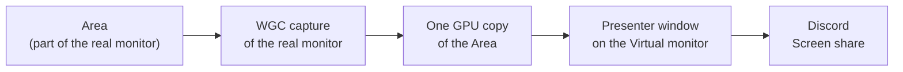

# Architecture

Discord can share a whole screen, with system audio, or one window. It can't share part of a screen. cropcast turns part of a screen into a whole screen: it adds a Virtual monitor the size of the Area and keeps the Area's picture on it, so Discord's ordinary Screen share does the rest. Terms (Area, Border, Edit mode, Virtual monitor, Driver) are defined in [GLOSSARY.md](../GLOSSARY.md).

## Pipeline

- **Capture:** Windows.Graphics.Capture of the whole real monitor, BGRA8, cursor on, the yellow capture border off, a ~16 ms minimum interval so a 240 Hz screen still mirrors at 60 fps.
- **Copy:** each frame is one `CopySubresourceRegion` of the Area into the back buffer of a flip-model swapchain. Nothing is scaled, so the stream is the Area pixel for pixel; the Area's sides are always even because video encoders need it.
- **Present:** the swapchain belongs to a borderless, topmost, never-activated window that covers the Virtual monitor. Discord captures that screen through DWM like any other, which is why the window must stay capturable while the Border must not.
- **Placement:** the Virtual monitor touches the real one only at its bottom-right corner, so the cursor and new windows rarely wander onto it.
- Every monitor change invalidates the WGC capture, so cropcast restarts it with a fresh `HMONITOR` after each add, remove or mode change.

Code: [src/mirror.rs](../src/mirror.rs) (capture and copy), [src/virtual_monitor.rs](../src/virtual_monitor.rs) (presenter and the on/off lifecycle).

## Edit mode

Holding Ctrl+Alt shows the Border. cropcast polls the keys rather than installing a keyboard hook, so it adds nothing to the input path of a running game. The Border is one DirectComposition + Direct2D surface over the real monitor: the outside of the Area is shaded, the Area gets a 2 px frame with corner brackets, a readout shows W × H and the ratio, and an amber guide shows where a snap to 16:9 or 21:9 will land. It is excluded from capture (`WDA_EXCLUDEFROMCAPTURE`), so viewers never see it, and it costs nothing while hidden.

- A **move** only shifts the copy box, so it shows on the stream live.
- A **resize** changes the Virtual monitor's mode in place, once, when Ctrl+Alt is released.

Code: [src/edit.rs](../src/edit.rs) (geometry, snapping), [src/border.rs](../src/border.rs).

## The Driver

The Virtual monitor comes from [SudoVDA](https://github.com/SudoMaker/SudoVDA), an indirect display driver that adds and removes monitors at any size and refresh rate by IOCTL, with no admin rights once installed.

1. **Install, once.** The Driver is built in CI from a pinned commit of the fork, signed with cropcast's own certificate and embedded in the exe. The first time the Virtual monitor is turned on without a Driver that speaks cropcast's protocol, cropcast relaunches itself elevated (one UAC prompt), trusts its certificate, creates the device and installs the package. A declined or failed install leaves nothing behind.
2. **On:** `IOCTL_ADD` creates the Virtual monitor at the Area's size and 60 Hz. A thread pings the driver every second; if cropcast dies, SudoVDA's 3 s watchdog removes the monitor by itself.
3. **Resize:** `IOCTL_UPDATE_MODE` switches the same monitor to the new size.
4. **Off:** the presenter is hidden first, then the monitor is removed, and the desktop is as it was.
5. **Remove driver…** (or `--uninstall`) removes the device, the package and the certificate.

Code: [src/vda.rs](../src/vda.rs) (IOCTLs, watchdog), [src/driver.rs](../src/driver.rs) (install and removal).

### Why the fork

Stock SudoVDA fixes a monitor's mode list when the monitor is added, so the only way to change its size is to remove it and add it again. Discord treats a re-added monitor as a new screen and shows viewers "Stream Paused". A mode change on the *same* monitor keeps the stream live, so [lumi-fiona/SudoVDA](https://github.com/lumi-fiona/SudoVDA) adds one IOCTL, `IOCTL_UPDATE_MODE` (protocol 0.3), which calls `IddCxMonitorUpdateModes2` with the new size. Any even size switches in place.

## Dead ends

- **Remove + re-add per resize:** it worked in the spike, then a retest showed it pauses the Discord share. Hence the fork.
- **Shipping Apollo's signed SudoVDA:** no build work, but installing it means trusting Apollo's self-signed certificate as a machine-wide root, and whoever holds that key could sign anything the PC would trust. cropcast signs its own build instead, and removes Apollo's certificate when it replaces Apollo's driver.
- **Feeding frames into the driver:** Discord captures the screen from DWM, before the driver sees a frame.
- **DXGI Desktop Duplication:** drops on every mode change and needs the cursor drawn by hand.
- **Confining the cursor with `ClipCursor`:** it fights games.

## Decisions

- [ADR 0001: Mirror the Area through a window on a Virtual monitor](adr/0001-capture-route.md)
- [ADR 0002: Ship SudoVDA signed with cropcast's own certificate](adr/0002-own-signed-driver.md)
